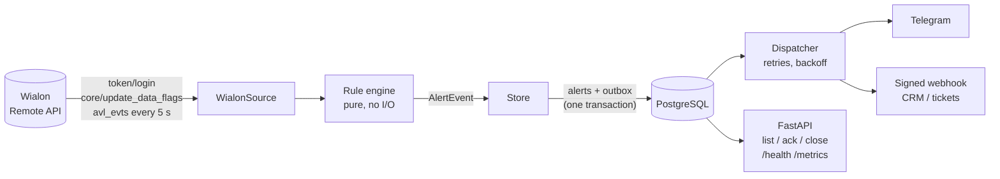

# wialon-fleet-alerts

[](https://github.com/darkside0001/wialon-fleet-alerts/actions/workflows/ci.yml)


A small service that watches a [Wialon](https://wialon.com) fleet in real time and tells dispatchers
when something needs a human: a tracker went silent, a truck is speeding, fuel disappeared from a
parked excavator, someone cut the tracker's power, the GPS fix is gone, or a vehicle left the depot at
night. Alerts go to Telegram and to signed webhooks (CRM, ticket system), and can be acknowledged through
a small HTTP API.

Wialon has its own notifications, and they are good for simple cases. This service exists for the
cases where they were not enough in practice:

* **one rules file in git** for the whole fleet instead of notifications clicked together per unit and
  per account, so changes are reviewed and can be rolled back;
* **debounced conditions with automatic resolve**: "speed > 90 for 2 minutes", then a
  "resolved" message when it is over, instead of one message per tracker packet;
* **fuel drain detection that waits for the level to settle** and reports the real amount, using the
  same calibration table as the Wialon sensor and a median filter against fuel sloshing;
* **delivery that survives outages**: alerts and notifications are written in one transaction
  (outbox), and the dispatcher retries Telegram/webhooks with backoff, so a Telegram outage or a restart
  does not lose alerts;
* **an API** so a dispatcher (or a CRM) can list, acknowledge and close alerts.

> Built from the problems I dealt with supporting fleet monitoring on Wialon Hosting (Teltonika FMB
> trackers, RS-485 fuel level sensors, Telegram bots for the operations team) and in freelance Wialon
> work. This is a standalone open-source implementation: it contains no client code or data, and the
> demo trace in `samples/` is synthetic.

## Quick start (no Wialon account needed)

```bash
pip install -e ".[dev]"
fleet-alerts replay samples/demo-trace.jsonl
```

The demo trace is one invented day of six vehicles, each with one typical problem:

```text
Opened            Resolved          Unit                      Rule              Severity  Alert
----------------  ----------------  ------------------------  ----------------  --------  ----------------------------------
2026-11-18 01:41  -                 Excavator 03 · CAT 320    fuel-drain        critical  Fuel drop 46 L while parked
2026-11-18 08:10  2026-11-18 08:14  Truck 01 · Isuzu NQR      overspeed         warning   Speed 111 km/h (limit 90)
2026-11-18 11:12  2026-11-18 11:25  Truck 09 · Shacman X3000  gps-lost          critical  No GPS fix (0 satellites)
2026-11-18 14:09  2026-11-18 14:25  Van 07 · GAZelle Next     power-cut         critical  External power 0.3 V (below 9.0 V)
2026-11-18 16:47  -                 Pickup 11 · Toyota Hilux  offline           warning   No data for 1.0 h
2026-11-18 23:13  -                 Fuel truck 05 · MAN TGS   depot-night-exit  warning   left zone depot
```

45 L were drained in the trace; the detector reports 46 L after median smoothing. Sloshing while the
excavator works (±8 L) and the 17:30 refuel do not raise alerts.

### Full stack with Docker

```bash
cp .env.example .env        # set POSTGRES_PASSWORD and API_KEY
docker compose up --build
curl -s -H "X-API-Key: $API_KEY" http://127.0.0.1:8080/api/alerts?status=active | jq
```

The worker plays the demo trace 600x faster than real time against PostgreSQL; alerts appear in the
worker log and in the API within a couple of minutes.

### Live mode

1. Create a read-only access token in Wialon (User settings → Access tokens).
2. Put `WIALON_TOKEN` (and `WIALON_HOST` for Wialon Local or a white-label hosting) in `.env`.
3. Copy `samples/rules.yaml`, set your unit ids, zones and tank calibrations, add a Telegram or webhook
   notifier, and check it: `fleet-alerts check-config --rules my-rules.yaml`.
4. Run `fleet-alerts worker --rules my-rules.yaml` and `fleet-alerts api --rules my-rules.yaml`
   (or change the worker command in `docker-compose.yml` to `["worker"]`).

## Rules

| Type | Fires when | Resolves | Typical cause |
|---|---|---|---|
| `offline` | no message for `after_minutes` | next message | tracker unplugged, SIM out of money, vehicle in a dead zone |
| `overspeed` | speed > `limit_kmh` for `min_duration_s` (needs a GPS fix) | speed ≤ limit − `hysteresis_kmh` | driver behaviour |
| `power_loss` | external voltage (`pwr_ext`) below `below_volts` | voltage back above threshold + 0.5 V | battery disconnected, wire cut, tamper |
| `gps_lost` | messages arrive without a fix (< `min_satellites`) for `min_duration_s` | fix is back | damaged antenna, GPS jammer |
| `fuel_drain` | smoothed level drops ≥ `min_litres` within `window_minutes` while speed ≤ `max_speed_kmh` | one-shot, closed by an operator | fuel theft, leak |
| `geofence` | unit `enter`s or `exit`s a circle/polygon zone, optionally only in `active_hours` | one-shot | vehicle used after hours |

Every rule can be limited to `units: [...]` or `groups: [...]` and has a `severity`
(`info` / `warning` / `critical`). Notifiers subscribe by minimum severity and group. Details and
tuning advice: [docs/rules.md](docs/rules.md).

## How it works



The worker subscribes once and then reads only changes through `avl_evts`, which is how Wialon's own
web apps get live data; there is no per-unit polling. Architecture, failure handling and design
decisions: [docs/architecture.md](docs/architecture.md).

## API

All `/api/*` endpoints need the `X-API-Key` header.

| Method | Path | |
|---|---|---|
| GET | `/api/alerts?status=active\|open\|acknowledged\|resolved&rule=&unit_id=&limit=` | list alerts, newest first |
| GET | `/api/alerts/{id}` | one alert |
| POST | `/api/alerts/{id}/ack` `{"by": "anna"}` | acknowledge |
| POST | `/api/alerts/{id}/close` `{"by": "anna"}` | close a one-shot alert after checking it |
| GET | `/api/units?silent_minutes=60` | units and their last position |
| GET | `/api/rules` | loaded rules |
| GET | `/health` | `ok` / `degraded` (worker heartbeat older than 5 min) |
| GET | `/metrics` | Prometheus metrics: alerts by rule/severity/status, silent units, notification queue |

Interactive docs at `/docs` when the API runs.

## Security

* Secrets (Wialon token, Telegram bot token, webhook secret, API key) come only from environment
  variables; the rules file references them as `${NAME}` and is safe to commit. `.env` is git-ignored
  and gitleaks runs in CI.
* The Wialon token and session id are sent in POST bodies, never in URLs, and are masked in every error
  message. Plain HTTP to Wialon is refused. httpx request logging is turned off because the Telegram Bot
  API keeps the token in the URL path.
* Webhooks are HTTPS-only and signed with HMAC-SHA256 over `timestamp.body`;
  `fleet_alerts.notify.webhook.verify_signature` shows the receiving side, including replay protection.
* The API compares keys in constant time, validates input, and sends `nosniff` / `no-store` headers.
  Unit names from Wialon are HTML-escaped before they go into Telegram messages.
* Containers run as a non-root user with a read-only filesystem, no capabilities and
  `no-new-privileges`; the API port is bound to localhost and meant to sit behind a TLS reverse proxy.

## Development

```bash
pip install -e ".[dev]"
pytest -q                 # 79 tests: rules, store, notifiers, Wialon client, worker, API, CLI
ruff check . && ruff format --check .
python scripts/make_demo_trace.py > samples/demo-trace.jsonl   # regenerate the synthetic trace
```

CI runs the tests on Python 3.11–3.13, the store against a real PostgreSQL, builds the Docker image and
replays the demo trace inside it, and scans the history with gitleaks.

Related: [wialon-tools](https://github.com/darkside0001/wialon-tools), a CLI for one-off Wialon jobs
(fleet health checks, fuel calibration tables, report export).

## License

MIT
