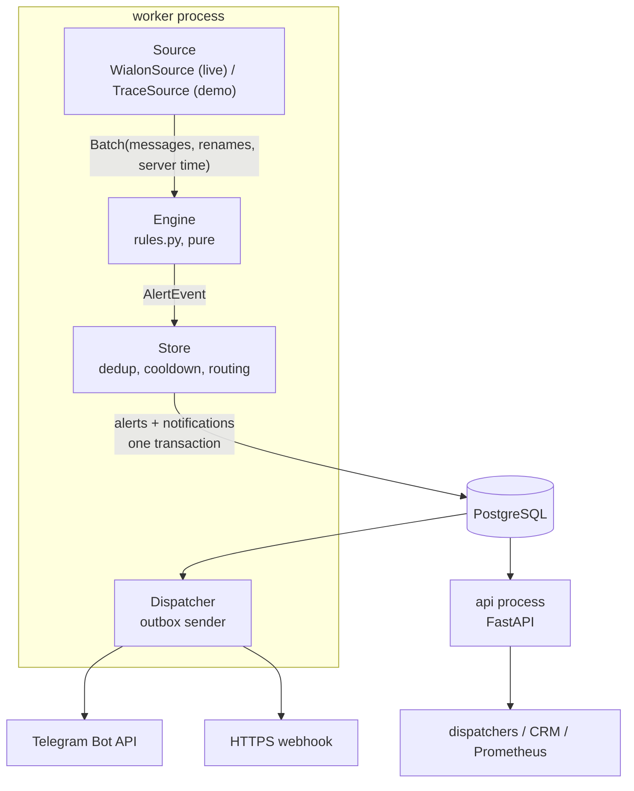
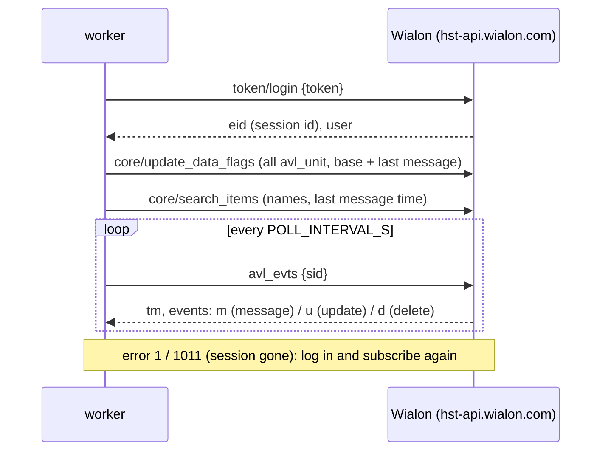
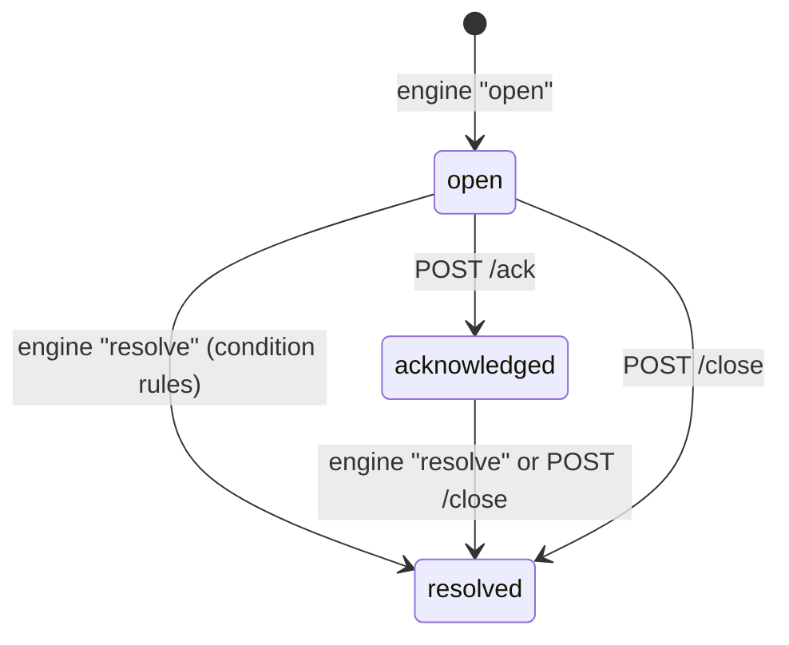

# Architecture

## Components

| Module | Responsibility |
|---|---|
| `wialon.py` | Remote API client: `token/login`, `core/update_data_flags`, `core/search_items`, `avl_evts`; retries, error codes, secret masking |
| `sources.py` | Turns `avl_evts` events into `Message` objects; `TraceSource` replays a JSONL trace on a simulated clock |
| `rules.py` | The six rule types and the `Engine` that runs them per unit. No I/O |
| `store.py` | Applies engine events to the database: one active alert per unit+rule, cooldown for one-shot alerts, routing to notifiers, ack/close, state restore after restart |
| `notify/` | Telegram and webhook channels, message rendering, outbox dispatcher with backoff |
| `worker.py` | The loop: poll, evaluate, persist, dispatch, heartbeat; reconnect and backoff on errors |
| `api.py` | Alerts/units/rules API with API-key auth, `/health`, `/metrics` |
| `cli.py` | `worker`, `api`, `replay`, `check-config` |

## Getting data from Wialon

* **Why `avl_evts` and not `core/search_items` in a loop.** After the subscription Wialon pushes only
  what changed, so the cost does not grow with the number of polls, and it is the same mechanism the
  Wialon web interface uses. Each call also keeps the session alive (Wialon drops idle sessions after
  about five minutes).
* **Server time.** The offline rule uses `tm` from `avl_evts` (Wialon's clock), not the local clock,
  so a worker with a drifting clock does not mark the whole fleet offline.
* **Seeding.** On start the last message time of every unit comes from `core/search_items`, so a tracker
  that was already silent before the worker started is still reported.
* **Out-of-order data.** Trackers upload their black box after a connection loss. Messages older than
  the last processed one are stored for the unit's position history but are not re-evaluated, so a
  buffered hour of driving does not produce a burst of stale alerts.

## Alert lifecycle

* Condition rules (offline, overspeed, power loss, GPS loss) have at most one active alert per
  unit and rule. Repeated "open" events while it is active are ignored.
* One-shot rules (fuel drain, geofence) create a new alert for every event, but not more often than
  `cooldown_minutes` per unit and rule.
* A "resolved" notification goes only to the channels that received the "open" one.

## Reliability

| Failure | What happens |
|---|---|
| Telegram or webhook down | Notification stays `pending`, retried after 30 s, 1, 2, 4 … min (max 1 h); Telegram `retry_after` is honoured; after 8 attempts `failed` and visible in `/metrics` |
| Wrong chat id / bot removed from group (4xx) | Marked `failed` immediately, no retry storm |
| Wialon session expired, IP changed | Error 1/1011: log in, subscribe, continue |
| Wialon busy (1003) or HTTP error | Retried in the client, then exponential backoff in the worker (max 5 min) |
| Worker restart | Open alerts are loaded back into the engine, so conditions that cleared while it was down still resolve; pending notifications are sent |
| Unexpected exception in one batch | Logged with traceback, the loop continues |
| Worker stopped or stuck | `/health` turns `degraded` after 5 minutes without a heartbeat; `fleet_alerts_worker_heartbeat_age_seconds` for alerting |

## Design decisions

* **The engine is pure.** Rules receive data and return events; the database and the network are
  outside. This keeps the rules testable with a few lines of data and lets `replay` run exactly the
  production code on a recorded trace, which is how rules are tuned before they go live.
* **Outbox instead of sending from the rule.** Writing the alert and its notifications in one
  transaction means an alert is never sent without being stored, or stored without being sent.
* **YAML for rules, environment for secrets.** Rules are reviewed in git like code; secrets never are.
* **Wialon is the source of truth for unit names.** The rules file holds only ids, groups and tank
  calibrations, so renaming a unit in Wialon does not require a config change.
* **Integer unix timestamps in the database.** Same behaviour on SQLite (tests) and PostgreSQL
  (production), no time zone surprises; conversion to local time happens only when rendering.
* **Tables are created on start (`create_all`).** Enough for a single-service schema; a migration tool
  (Alembic) is the next step once the schema has to change in place.

## Scaling notes

One worker with one Wialon session handles a few thousand units: `avl_evts` returns only changes and the
engine does constant work per message. Above that, run one worker per Wialon account or resource
(each with its own token and rules file) against the same database; the API is stateless and can be
scaled horizontally.
